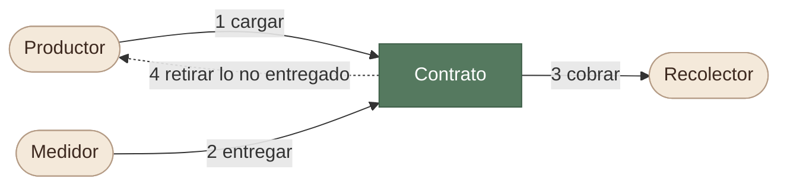

<picture>
  <source media="(prefers-color-scheme: dark)" srcset="assets/portada-oscura.svg">
  
</picture>

<br>

<p align="center">
  <a href="https://github.com/jfacundoayala/boleto-lleno/actions/workflows/tests.yml"></a>
  <a href="https://stellar.expert/explorer/testnet/contract/CCKXXTVEZXKXANOEJBYKLSBWOLR5CZ72I4KBJY27QIN3DKAK6BSXIHOI"></a>
  
  <a href="LICENSE"></a>
</p>

<p align="center">
  <a href="https://jfacundoayala.github.io/boleto-lleno/"><b>Ver en vivo</b></a> ·
  <a href="#el-problema">Problema</a> ·
  <a href="#la-solución">Solución</a> ·
  <a href="#cómo-funciona">Cómo funciona</a> ·
  <a href="#probado-en-testnet">Testnet</a> ·
  <a href="#tests">Tests</a> ·
  <a href="#cómo-correrlo">Cómo correrlo</a>
</p>

Un boleto de café que solo se puede entregar si la plata para pagarlo ya está apartada.

> Tarea "Primer contrato inteligente en Stellar" del Pura Vida Bootcamp, por Juan Facundo Ayala.

## El problema

En algunos cafetales de Costa Rica el recolector recibe un boleto o una ficha por cada
cajuela que recoge. Después lo cambia por plata. **Ese boleto es una promesa y quien lo
recibe no puede ver si la plata está.**

- **La ley pone un plazo.** Prohíbe pagar con vales o fichas. Hace una excepción con el
  café, donde se acostumbre, si se cambian por dinero dentro de la semana
  ([Código de Trabajo, artículo 165](https://www.tse.go.cr/pdf/normativa/codigodetrabajo.pdf)).
- **Se sigue usando.** En la finca del CICAFE, el centro de investigaciones en café, dan
  una ficha por cajuela y "al final de la semana las canjean" para cobrar por depósito
  ([Mosaico CSI, 2026](https://mosaicocsi.com/2026/04/21/cafe-con-aroma-a-frontera/)). El
  [Icafé](https://www.icafe.cr/icafe/preguntas-frecuentes/) también nombra los boletos
  entre las formas de pago más comunes (pregunta 9).
- **La plata podía llegar después.** Antes, muchos productores pequeños daban boletos
  porque todavía no tenían el efectivo. Lo conseguían cuando les pagaba el beneficiador,
  por lo general al final de la semana
  ([Revista Herencia, UCR, 2020](https://archivo.revistas.ucr.ac.cr//index.php/herencia/article/download/43300/43537/)).

La ley pone un plazo, pero el boleto no muestra si se va a cumplir. No encontré un caso
probado de boletos sin pagar y no digo que sea lo común. Lo que busco es que el recolector
no tenga que confiar a ciegas.

### Para quién es

Para una finca pequeña que ya paga con boletos y puede apartar la plata antes de medir el
café. No es para todo el sector cafetalero.

### Cómo se resuelve hoy

| Hoy | Qué falta |
| :-- | :-- |
| Efectivo al medir | Se cobra en el momento, pero hay que llevar la plata al cafetal |
| Boleto o ficha | Se puede entregar sin plata detrás y se puede perder |
| Cuaderno | Lo tiene el productor y tampoco muestra si la plata está |
| Transferencia | Se hace por día o por semana y antes no se ve si la plata está |

## La solución

Es como una caja transparente con llave. El productor mete la plata de 5 boletos. Cuando
el medidor le da 3 a Rosa, la plata de esos 3 ya es de ella. El productor solo puede sacar
la de los otros 2.

### Por qué lo elegí

El boleto de café es una promesa de pago y un contrato puede cambiar esa promesa por plata
que ya está apartada. Además es un problema pequeño y se entiende con cuatro acciones.

No hablé con recolectores ni con productores. Falta preguntarles si usarían una billetera
y cómo pasarían la plata a colones.

## Cómo funciona



| Acción | Quién firma | Qué hace |
| :-- | :-- | :-- |
| `cargar(boletos)` | Productor | Aparta la plata de esos boletos |
| `entregar(numero, recolector, boletos)` | Medidor | Da boletos, solo si hay plata |
| `cobrar(recolector)` | Cualquiera | Cambia sus boletos por plata, que solo puede ir a él |
| `retirar(boletos)` | Productor | Recupera la plata de los boletos que nadie tiene |

También se puede mirar sin firmar con `boletos`, `estado` y `datos`.

La idea entera está en tres líneas de `entregar`
([src/lib.rs](src/lib.rs#L141-L143)):

```rust
if boletos > estado.libres {
    return Err(Error::SinLibres); // acá está la idea: no hay boleto vacío
}
```

> [!IMPORTANT]
> Con XLM, la plata del contrato siempre alcanza para todos los boletos, los libres y los
> entregados.

<details>
<summary><b>Errores del contrato</b></summary>

| Error | Cuándo pasa |
| :-- | :-- |
| 1 `ValorInvalido` | El boleto vale menos de 1 XLM |
| 2 `CantidadInvalida` | Se piden 0 boletos |
| 3 `SinLibres` | No hay tantos boletos con plata |
| 4 `NumeroInvalido` | La entrega está repetida o se saltó una |
| 5 `RecolectorInvalido` | El recolector es el propio contrato |
| 6 `NadaParaCobrar` | Ese recolector no tiene boletos |

</details>

### Decisiones

- **Por qué no pagar directo.** Es más simple. Elegí el boleto porque respeta la costumbre,
  junta varias entregas en un solo pago y la plata queda apartada desde antes.
- **Por qué un contrato.** Un cuaderno compartido dice que la plata está y el contrato la
  tiene.
- **Por qué cualquiera puede pedir el cobro.** La plata solo puede ir al recolector. Así
  otra persona puede pedirlo y pagar la comisión de la red.
- **Por qué cada entrega lleva un número.** Si el medidor la manda dos veces por error, la
  segunda falla.
- **Por qué 1 XLM como mínimo.** Con eso el cobro puede activar la cuenta de quien nunca
  tuvo una
  ([CAP-73](https://github.com/stellar/stellar-protocol/blob/master/core/cap-0073.md)).
  Ese XLM queda de reserva. Los ejemplos usan boletos de 2 XLM solo para probar.

### Qué no hace

- No mide el café. Si el medidor anota de menos, el contrato no lo sabe.
- No frena a un medidor cómplice. El daño no pasa de lo que el productor cargó.
- No le da plata a quien no la tiene. Sirve para quien puede apartarla antes.
- No obliga a cargar. El productor puede retirar lo que todavía no se entregó.
- No anula un boleto mal entregado ni recupera una clave perdida.
- No paga en colones y el XLM cambia de precio. No alcanza para cumplir la ley por sí solo.
- No revisa la moneda. Está pensado para XLM y se puede mirar con `datos`.
- No devuelve la plata que alguien mande por fuera de `cargar`.

> [!NOTE]
> Es una práctica en Testnet y no tiene auditoría profesional.

## Probado en Testnet

El contrato está publicado en
[`CCKXXT…BSXIHOI`](https://stellar.expert/explorer/testnet/contract/CCKXXTVEZXKXANOEJBYKLSBWOLR5CZ72I4KBJY27QIN3DKAK6BSXIHOI)
con boletos de 2 XLM.

| Paso | Libres | De Rosa | Resultado |
| :-- | :-: | :-: | :-- |
| Se publica con boletos de 2 XLM | 0 | 0 | [Contrato creado](https://stellar.expert/explorer/testnet/tx/f100f56413d17956c4a8ed8ac05a72ebb9fb9387f239227553d1eb75ca3e6947) |
| El productor carga 5 | 5 | 0 | [Entran 10 XLM](https://stellar.expert/explorer/testnet/tx/c0ba35c7c0b05708e468c4df76defa2ba05f38a81572b3e241b165340c5edaee) |
| El medidor le entrega 3 a Rosa | 2 | 3 | [Rosa tiene 3 boletos](https://stellar.expert/explorer/testnet/tx/39d393f85313ccb2bc4e44b8a2a490f654354f781720c736214bcdec28514aab) |
| El productor quiere retirar 3 | 2 | 3 | Rechazado, error 3 |
| El productor retira 2 | 0 | 3 | [Vuelven 4 XLM](https://stellar.expert/explorer/testnet/tx/d4218567d9849efe653b5891ede37b24e5ba35a6508175e565eb5e4c0a86dda2) |
| El medidor quiere entregar 1 más | 0 | 3 | Rechazado, error 3 |
| Otra cuenta pide el cobro para Rosa | 0 | 0 | [Le llegan 6 XLM](https://stellar.expert/explorer/testnet/tx/40cff2635620feeddf85dad88d12f13a7198d44a8f394e40d24165de1be3e9fc) |
| Se pide el cobro otra vez | 0 | 0 | Rechazado, error 6 |

**Rosa no tenía cuenta en la red y no firmó nada.** El cobro
[activó su cuenta](https://stellar.expert/explorer/testnet/account/GCG32KQZE7FK4TDWGQGXYO3QMOBFPWEJMYM7XH7JYNAKZJ36VF223VSH)
con 6 XLM. Los rechazos no tienen link porque la red los frena antes de mandarlos.

En la [web del proyecto](https://jfacundoayala.github.io/boleto-lleno/) se ve cómo está el
contrato ahora, leído en vivo de Testnet.

<details>
<summary><b>Ver cómo quedó el contrato</b></summary>

```bash
stellar keys generate jurado --network testnet --fund
stellar contract invoke --network testnet --source jurado \
  --id CCKXXTVEZXKXANOEJBYKLSBWOLR5CZ72I4KBJY27QIN3DKAK6BSXIHOI -- estado
```

</details>

## Tests

Son 22 y están en [`src/test.rs`](src/test.rs).

| Qué prueban | Para qué |
| :-- | :-- |
| El camino completo | Cargar, entregar, cobrar y retirar |
| No hay boleto vacío | Sin plata no se entrega y lo entregado no se retira |
| El cobro | No se cobra dos veces y la plata le llega al recolector |
| Las firmas | Cada uno firma lo suyo, también si productor y medidor son la misma cuenta |
| Lo que queda a la vista | Errores, eventos y tiempo de vida de los datos |

## Cómo correrlo

Hace falta Rust 1.91 o más nuevo y la
[Stellar CLI](https://developers.stellar.org/docs/tools/cli).

```bash
git clone https://github.com/jfacundoayala/boleto-lleno
cd boleto-lleno
rustup target add wasm32v1-none
cargo test
stellar contract build
```

```text
boleto-lleno
├── src
│   ├── lib.rs     el contrato
│   └── test.rs    los tests
├── assets         la portada
├── docs           la web que lee el contrato en vivo
└── Cargo.toml     la configuración
```

## Licencia

[MIT](LICENSE)
