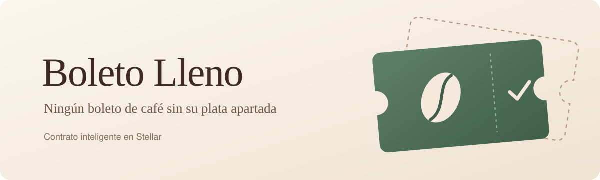
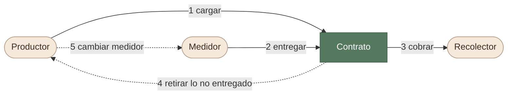

<picture>
  <source media="(prefers-color-scheme: dark)" srcset="assets/portada-oscura.svg">
  
</picture>

[](https://github.com/jfacundoayala/boleto-lleno/actions/workflows/tests.yml)

Un boleto de café que solo se puede entregar si la plata para pagarlo ya está apartada.

Es mi tarea "Primer contrato inteligente en Stellar" del Pura Vida Bootcamp. El contrato
está en Testnet y se puede ver andando en la
[web del proyecto](https://jfacundoayala.github.io/boleto-lleno/).

## El problema

En algunos cafetales de Costa Rica el recolector recibe un boleto o una ficha por cada
cajuela que recoge. Después lo cambia por plata. **Ese boleto es una promesa y quien lo
recibe no puede ver si la plata está.**

- **La ley pone un plazo.** Prohíbe pagar con vales o fichas. Hace una excepción con el
  café, donde se acostumbre, si se cambian por dinero dentro de la semana
  ([Código de Trabajo, artículo 165](https://www.tse.go.cr/pdf/normativa/codigodetrabajo.pdf)).
- **Se sigue usando.** En la finca del CICAFE, el centro de investigaciones en café, dan
  una ficha por cajuela y "al final de la semana las canjean" para cobrar por depósito
  ([Mosaico CSI, 2026](https://mosaicocsi.com/2026/04/21/cafe-con-aroma-a-frontera/)). El
  [Icafé](https://www.icafe.cr/icafe/preguntas-frecuentes/) también nombra los boletos
  entre las formas de pago más comunes (pregunta 9).
- **La plata podía llegar después.** Antes, muchos productores pequeños daban boletos
  porque todavía no tenían el efectivo. Lo conseguían cuando les pagaba el beneficiador,
  por lo general al final de la semana
  ([Revista Herencia, UCR, 2020](https://archivo.revistas.ucr.ac.cr/index.php/herencia/article/download/43300/43537/)).

La ley pone un plazo, pero el boleto no muestra si se va a cumplir. No encontré un caso
probado de boletos sin pagar y no digo que sea lo común. Lo que busco es que el recolector
no tenga que confiar a ciegas.

### Para quién es

Para una finca pequeña que ya paga con boletos y puede apartar la plata antes de medir el
café. No es para todo el sector cafetalero.

### Cómo se resuelve hoy

| Hoy | Qué falta |
| :-- | :-- |
| Efectivo al medir | Hay que llevar la plata al cafetal |
| Boleto o ficha | Se puede entregar sin plata detrás y se puede perder |
| Cuaderno | Lo lleva el productor y nadie más lo ve |
| Transferencia | Llega días después |

## La solución

Es como una caja transparente con llave. El productor mete la plata de 5 boletos. Cuando
el medidor le da 3 a Rosa, la plata de esos 3 ya es de ella. El productor solo puede sacar
la de los otros 2.

### Por qué lo elegí

El boleto de café es una promesa de pago y un contrato puede cambiar esa promesa por plata
que ya está apartada. Además es un problema pequeño y se entiende con pocas acciones.

No hablé con recolectores ni con productores. Falta preguntarles si usarían una billetera
y cómo pasarían la plata a colones.

## Cómo funciona



| Acción | Quién firma | Qué hace |
| :-- | :-- | :-- |
| `cargar(boletos)` | Productor | Aparta la plata de esos boletos |
| `entregar(numero, recolector, boletos)` | Medidor | Da boletos, solo si hay plata |
| `cobrar(recolector)` | Cualquiera | Cambia sus boletos por plata, que solo puede ir a él |
| `retirar(boletos)` | Productor | Recupera la plata de los boletos que nadie tiene |
| `cambiar_medidor(medidor)` | Productor | Pone otro medidor, por ejemplo si perdió la clave |

También se puede mirar sin firmar con `boletos`, `estado` y `datos`.

La idea entera está en tres líneas de `entregar`
([src/contract.rs](https://github.com/jfacundoayala/boleto-lleno/blob/v3.0.0/src/contract.rs#L95-L97)):

```rust
if boletos > estado.libres {
    return Err(Error::SinLibres); // acá está la idea: no hay boleto vacío
}
```

Por eso la plata del contrato siempre alcanza para todos los boletos, los libres y los
entregados.

<details>
<summary><b>Errores del contrato</b></summary>

| Error | Cuándo pasa |
| :-- | :-- |
| 1 `ValorInvalido` | El boleto vale menos de 1 XLM o más de 10 000 |
| 2 `CantidadInvalida` | Se piden 0 boletos |
| 3 `SinLibres` | No hay tantos boletos con plata |
| 4 `NumeroInvalido` | La entrega está repetida o se saltó una |
| 5 `RecolectorInvalido` | El recolector es el propio contrato |
| 6 `NadaParaCobrar` | Ese recolector no tiene boletos |
| 7 `MedidorInvalido` | El medidor es el propio contrato |

</details>

### Decisiones

- **Por qué no pagar directo.** Sería más simple, pero el boleto respeta la costumbre, junta
  varias entregas en un solo pago y la plata queda apartada desde antes.
- **Por qué cualquiera puede pedir el cobro.** La plata solo puede ir al recolector. Así
  otra persona puede pedirlo y pagar la comisión de la red.
- **Por qué cada entrega lleva un número.** Si el medidor la manda dos veces por error, la
  segunda falla.
- **Por qué 1 XLM como mínimo.** Con eso el cobro puede activar la cuenta de quien nunca
  tuvo una
  ([CAP-73](https://github.com/stellar/stellar-protocol/blob/master/core/cap-0073.md)).
  Ese XLM queda de reserva. Los ejemplos usan boletos de 2 XLM solo para probar.
- **Por qué solo XLM.** Nadie elige la moneda, así nadie puede armar uno con una moneda falsa.

### Qué no hace

- No mide el café. Si el medidor anota de menos, el contrato no lo sabe.
- No frena a un medidor cómplice. El daño no pasa de lo que el productor cargó.
- No le da plata a quien no la tiene. Sirve para quien puede apartarla antes.
- No anula un boleto mal entregado ni revisa que la cuenta del recolector esté bien escrita.
- Si el productor pierde su clave, no hay arreglo.
- No paga en colones y el XLM cambia de precio. No alcanza para cumplir la ley por sí solo.
- No devuelve la plata que alguien mande por fuera de `cargar`.
- Si pasan 120 días sin movimientos, la red archiva los boletos y el contrato. La plata no
  se pierde, pero hay que restaurarlos antes de seguir.

Es una práctica en Testnet y no tiene auditoría profesional.

## Probado en Testnet

El contrato está publicado en
[`CBWS4O…XPLAYC`](https://stellar.expert/explorer/testnet/contract/CBWS4OR7LPKIK6TTYCTGWP2X2Y24VKSLAC6ALWIAUREGMYPKMKXPLAYC)
con boletos de 2 XLM.

| Paso | Libres | De Rosa | Resultado |
| :-- | :-: | :-: | :-- |
| Se publica con boletos de 2 XLM | 0 | 0 | [Contrato creado](https://stellar.expert/explorer/testnet/tx/b44c1ecac254f33af95610ae634969bd40c2eab50340c89978f27db18c6e4f91) |
| El productor carga 5 | 5 | 0 | [Entran 10 XLM](https://stellar.expert/explorer/testnet/tx/02980e603ba46c6e3e43fe398bbffe16912f88ae928be15689c40c72e7585d1c) |
| El medidor le entrega 3 a Rosa | 2 | 3 | [Rosa tiene 3 boletos](https://stellar.expert/explorer/testnet/tx/5fc949b94da576506f2360c06742398bbc3b83f7e35b44c069a99c6e4afd9f30) |
| El productor quiere retirar 3 | 2 | 3 | Rechazado, error 3 |
| El productor retira 2 | 0 | 3 | [Vuelven 4 XLM](https://stellar.expert/explorer/testnet/tx/f0b96ea8c1cd39b9ac4b92c6e4fd85b91f0ff5e739a1074879c888ecca61ef87) |
| El medidor quiere entregar 1 más | 0 | 3 | Rechazado, error 3 |
| Otra cuenta pide el cobro para Rosa | 0 | 0 | [Le llegan 6 XLM](https://stellar.expert/explorer/testnet/tx/afe4666a075b7ea546c2c29ebfddec07dd982e95d28be865f4a10591f388edf3) |
| Se pide el cobro otra vez | 0 | 0 | Rechazado, error 6 |

**Ana no tenía cuenta en la red y no firmó nada.** El productor
[cargó 1 boleto](https://stellar.expert/explorer/testnet/tx/b474625641e8791549d4bee98c9dcf20caa2d6a464d462847e09dcd00af07836),
el medidor [se lo dio](https://stellar.expert/explorer/testnet/tx/5b355aa194896b4b9a2f7a014921ec1e84c98a170076edc83ebc229a7446be08)
y el [cobro](https://stellar.expert/explorer/testnet/tx/8ac2a38f233e633afbe88babea625b697b99fae560024ad6e92be66a51b25047)
[creó su cuenta](https://stellar.expert/explorer/testnet/account/GBSOVBN5TFUASEK6TLDTKPME7O5OSITLUD47RG4UBR7W74WGOEGTVHYO)
con 2 XLM.

Al final el productor [cargó 4 más](https://stellar.expert/explorer/testnet/tx/8e3213482d86276f38cb976e6e76584e04256811f7e4cd20b618599756b6f599)
y [cambió el medidor](https://stellar.expert/explorer/testnet/tx/e1f54140bf09746b3d8b0e9272a307f4f94252cc5945d132e9363a943ccbe4d4).
El medidor anterior ya no pudo entregar y el nuevo
[le dio 2 a Rosa](https://stellar.expert/explorer/testnet/tx/e5ada3e125e7bc361c937d1483064c2a8b1ada7ed714721ff23fce3a884a3b45).
Quedaron 2 boletos libres y 2 de Rosa sin cobrar, para que se vean en la web.

Los rechazos no tienen link porque la red los frena antes de mandarlos.

En la [web del proyecto](https://jfacundoayala.github.io/boleto-lleno/) se ve cómo está el
contrato ahora, leído en vivo de Testnet.

<details>
<summary><b>Ver cómo quedó el contrato</b></summary>

```bash
stellar keys generate jurado --network testnet --fund
stellar contract invoke --network testnet --source jurado \
  --id CBWS4OR7LPKIK6TTYCTGWP2X2Y24VKSLAC6ALWIAUREGMYPKMKXPLAYC -- estado
```

</details>

## Qué se puede verificar

GitHub compila el contrato al crear la versión
[v3.0.0](https://github.com/jfacundoayala/boleto-lleno/releases/tag/v3.0.0_boleto-lleno_cli28.1.0)
y firma de dónde salió. stellar.expert compara el resultado con lo que está en la red y
muestra el contrato como verificado, desde el commit
[`0541a0b`](https://github.com/jfacundoayala/boleto-lleno/tree/v3.0.0).

```bash
gh release download v3.0.0_boleto-lleno_cli28.1.0 -R jfacundoayala/boleto-lleno
sha256sum boleto-lleno_v3.0.0.wasm
# da3d6878439ac63733016239a410f75fa4d9ab77d8df4282dd975cd2f6e8fc98
gh attestation verify boleto-lleno_v3.0.0.wasm -R jfacundoayala/boleto-lleno \
  --signer-repo stellar-expert/soroban-build-workflow
```

Las versiones anteriores siguen en Testnet pero ya no se usan. La primera dejaba elegir la
moneda y la segunda no tenía la release atada a su código.

## Tests

Están en [`src/test`](src/test), un archivo por tema:

- `flujo.rs`: el camino completo y el cobro, que no se repite y le crea la cuenta a quien
  no tenía.
- `limites.rs`: sin plata no se entrega y lo entregado no se retira.
- `firmas.rs`: cada uno firma lo suyo y el medidor anterior deja de poder entregar.
- `vista.rs`: eventos, datos y tiempo de vida.
- `azar.rs`: 25 recorridos de 80 pasos donde la plata del contrato siempre coincide con
  los boletos.

## Cómo correrlo

Hace falta Rust (rustup baja solo la versión del proyecto) y la
[Stellar CLI](https://developers.stellar.org/docs/tools/cli).

```bash
git clone https://github.com/jfacundoayala/boleto-lleno
cd boleto-lleno
cargo test
stellar contract build
```

```text
boleto-lleno
├── src
│   ├── lib.rs         arma el contrato
│   ├── contract.rs    las funciones públicas
│   ├── storage.rs     leer y guardar datos
│   ├── model.rs       los tipos
│   ├── errors.rs      los errores
│   ├── events.rs      los eventos
│   ├── constants.rs   valores fijos
│   └── test           los tests, por tema
├── docs           la web: index.html, estilo.css y app.js
├── assets         la portada
└── Cargo.toml     la configuración
```

## Licencia

[MIT](LICENSE)
